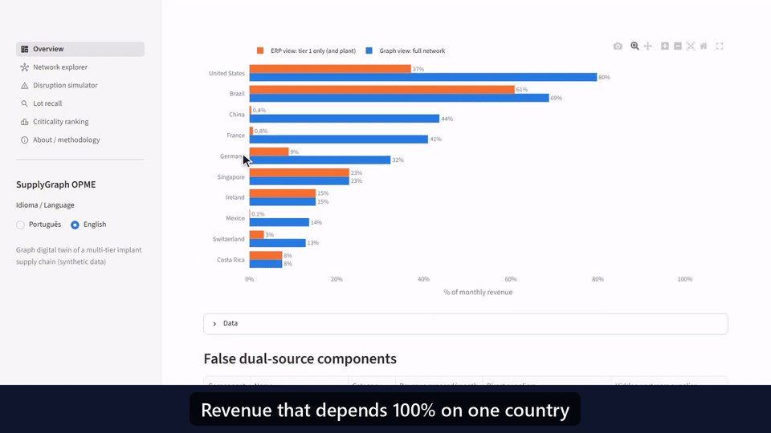
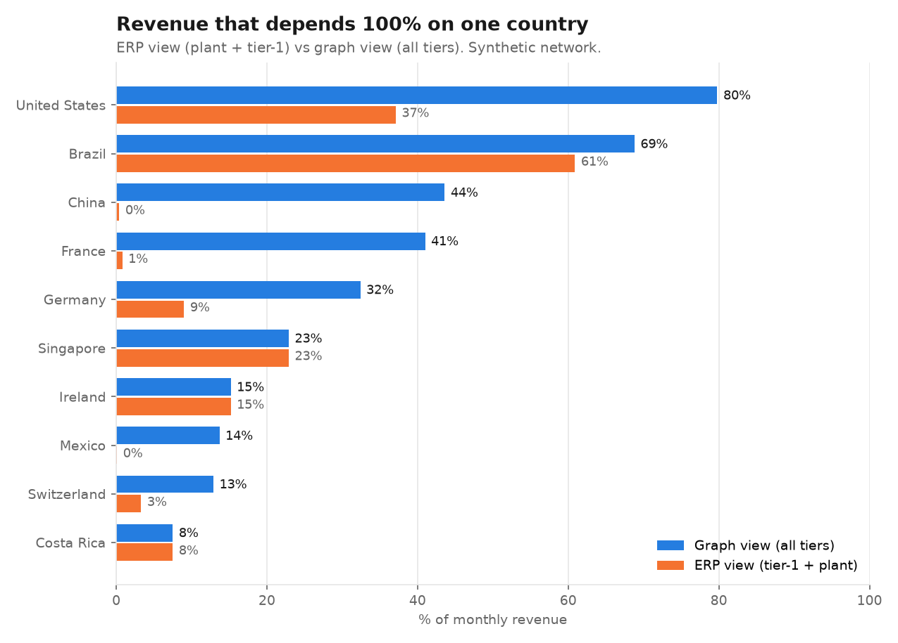
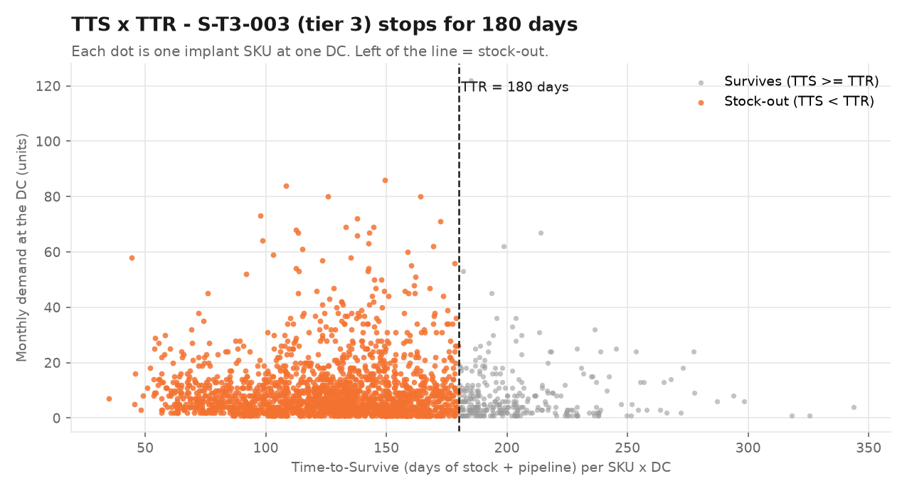
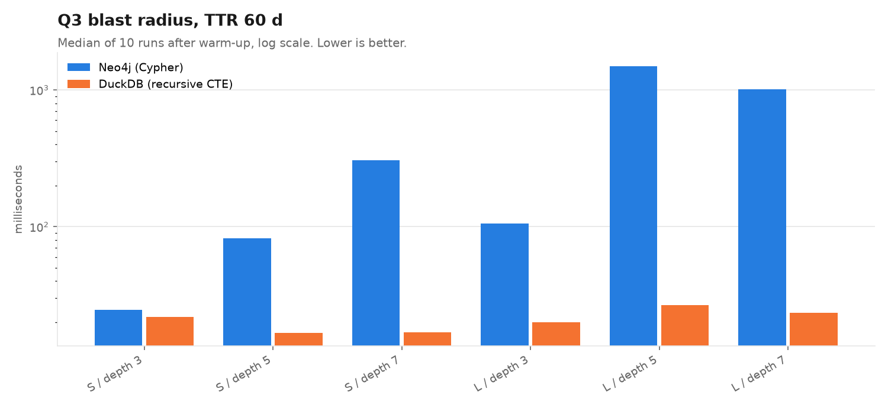

# SupplyGraph OPME

[](https://github.com/gorc-supply/supplygraph-opme/actions/workflows/ci.yml)


**A graph digital twin of a multi-tier supply network for orthopedic and cardiovascular implants (OPME):**
raw materials (titanium, cobalt-chromium, PEEK, UHMWPE...), tier-1/2/3 suppliers in 17 countries, plants, ports
and airports, Brazilian distribution centres, 1,400 hospitals and 58k lots traceable end to end - in Neo4j.

**Live demo: [supplygraph-opme.streamlit.app](https://supplygraph-opme.streamlit.app)** (Portuguese by default; English: [`?lang=en`](https://supplygraph-opme.streamlit.app/?lang=en)) · *Versão em português: [README.pt-BR.md](README.pt-BR.md)*

[](https://github.com/gorc-supply/supplygraph-opme/releases/download/v1.0-demo/supplygraph-demo-en-1080p.mp4)

**90 s video:** [English](https://github.com/gorc-supply/supplygraph-opme/releases/download/v1.0-demo/supplygraph-demo-en-1080p.mp4) · [Portuguese](https://github.com/gorc-supply/supplygraph-opme/releases/download/v1.0-demo/supplygraph-demo-pt-1080p.mp4) · [all versions and subtitles](https://github.com/gorc-supply/supplygraph-opme/releases/tag/v1.0-demo)

> **Thesis: supply-chain risk is a relationship problem, not a table-row problem.**
> "Which tier-3 supplier I have never heard of can stop half of my revenue?" is a recursive join nightmare in SQL
> and a path pattern in a graph. This project answers that question - and measures, honestly, what the graph costs
> and buys compared with a relational engine.

> **Data honesty.** The network is **synthetic** (fixed seed), calibrated with real open data: Brazil's 2024
> implant imports by country of origin, official NCM codes (Siscomex) and IBGE municipality data. Every R$ figure
> below is synthetic and illustrates the method - it is not a statement about the Brazilian OPME market.
> Details: [docs/data-sources.md](docs/data-sources.md).

## The business case in four numbers

| | ERP view (purchase orders, tier-1) | Graph view (whole network) |
|---|---|---|
| Revenue that cannot be produced without **China** | **0.4%** | **43.6%** |
| Level-1 components with 2+ suppliers that are really single-sourced (**false dual-source**) | 0 of 224 (they look safe) | **66 of 224 (29%)**, feeding **53% of revenue** |
| Position of the most dangerous supplier in a spend / tier-1 view | - | the **top 10 by revenue at risk are all tier-2/3**; the first tier-1 is **#74** |
| Time to trace a failed titanium lot to every implant and hospital | days of spreadsheets | **19 ms**: 105 implant lots, 180 hospitals, 26 states, 684 units to quarantine |



## What is inside

- **Data model** with constraints and indexes, plus a refinement of the brief: `BUYS_FROM` relationships that
  record which tier-2 each tier-1 *actually* buys from, so false dual-sources become visible
  ([data model and modelling decisions](docs/data-model.md)).
- **Reproducible pipeline**: deterministic generator with real anchors, idempotent `UNWIND/MERGE` loader,
  `neo4j-admin import` alternative, 9 graph data-quality checks run as tests.
- **Seven business analyses** in commented Cypher 25 ([analysis](docs/analysis.md)):
  BOM explosion and where-used, false dual-source, ERP-vs-graph country exposure, blast radius with
  Simchi-Levi's **Time-to-Survive x Time-to-Recover**, lot recall, alternative routes (Dijkstra / Yen),
  substitution.
- **Graph Data Science**: betweenness, weighted PageRank, WCC, Leiden, Node Similarity, FastRP + kNN, bridges,
  Dijkstra / Yen - written back as properties, and a **Supplier Criticality Index** (0-100) with a weight
  sensitivity analysis.
- **Benchmark graph vs relational**: the same 3 questions in Cypher and in DuckDB recursive CTEs over 6 network
  sizes, with identical answers in all 18 pairs ([benchmarks](docs/benchmarks.md)).
- **Streamlit app** (PT/EN): overview, network explorer, disruption simulator, lot recall, criticality ranking
  with live weights, methodology.

## Key results

**Blast radius (TTS x TTR).** If the tier-3 titanium-bar producer S-T3-003 stops for its time-to-recover
(180 days), stock and pipeline cover only **35 days**; 164 implants stock out, all 1,400 hospitals are hit and
**R$ 242 M** of revenue is at risk. Closing Guarulhos airport (GRU) for 60 days costs R$ 30 M and stock-outs
start on day 13.



**Graph algorithms.** Leiden finds three supply-base clusters (all cardio; hip + knee + trauma; spine) that cut
across the seven purchasing categories (purity 0.44): buyers of different categories are negotiating with the
same sub-tier. PageRank and the criticality index put tier-2 forging and coating hubs and tier-3 alloy producers
at the top; the ranking is stable under four alternative weightings (Spearman >= 0.90).

**Benchmark - the honest part.** DuckDB was **faster in all 18 cases** (1.1x to ~50x): these are whole-network
batch analytics, the sweet spot of a vectorised columnar engine, and Neo4j's time includes the network round trip.
The graph wins on expressiveness (3 vs 20, 10 vs 32, 26 vs 60 lines of code), on interactive point questions
(one supplier's blast radius ~0.3 s, a recall in ~19 ms) and on algorithms that SQL does not have.
[Full discussion](docs/benchmarks.md).



## Criticality index

`index = 100 x sum(weight_k x minmax(component_k))` with the weights in
[`config/scoring.yaml`](config/scoring.yaml): revenue at risk (TTS x TTR) 0.35, betweenness 0.15,
PageRank 0.15, sole-source flag 0.15, country geo-risk proxy 0.10, financial risk 0.10. All components are
min-max normalised across suppliers. The app's ranking page lets you move the weights and see the ranks change.

## Quickstart (Windows / PowerShell)

```powershell
git clone https://github.com/gorc-supply/supplygraph-opme.git
cd supplygraph-opme
uv sync --extra app --extra dev          # Python 3.12 + dependencies (uv installs Python if needed)
copy .env.example .env                    # set NEO4J_PASSWORD

# Neo4j Community + APOC + GDS
uv run sgraph up                          # Docker Compose if Docker Desktop is running...
uv run sgraph setup-portable              # ...or, without Docker: portable JDK 21 + Neo4j zip in .runtime/
uv run sgraph up --mode portable

uv run sgraph all                         # generate -> load -> validate -> analyze (Cypher + GDS + index)
uv run sgraph benchmark                   # Cypher vs DuckDB, 6 network sizes x 3 questions (~40 min)
uv run streamlit run app/streamlit_app.py # the app on http://localhost:8501
```

Other commands: `sgraph generate --profile ci|full|bench_*`, `sgraph stats`, `sgraph load --reset`,
`sgraph bulk-import` (neo4j-admin), `sgraph validate`, `sgraph analyze --step cypher|gds|criticality`,
`sgraph export-aura [--dry-run]`, `sgraph fetch-anchors`, `sgraph version`.

Tests: `uv run pytest` (generator tests always run; tests that need Neo4j wipe the database, so they only run with
`SGRAPH_TEST_ALLOW_RESET=1`).

## Stack

Neo4j Community 2026.10.2 (Cypher 25) · APOC + Graph Data Science 2026.10.2 · Python 3.12 (uv) · `neo4j` driver 6.4 ·
`graphdatascience` 2.4 · pandas · DuckDB 2.0 · Typer · pydantic · Streamlit 1.67 + neo4j-viz + Plotly · pytest ·
ruff · pre-commit · GitHub Actions (Neo4j service container). Exact versions and how they were checked:
[docs/VERSIONS.md](docs/VERSIONS.md).

## Repository map

```
config/          network.yaml (generator, all synthetic assumptions) · scoring.yaml (criticality weights)
cypher/          00_schema · 01_enrich · validation/ (9 checks) · analytics/ (9A-9G, commented) · benchmark/
src/supplygraph/ cli · generate/ (generator + open-data anchors) · load/ (UNWIND/MERGE + neo4j-admin)
                 validate/ · analytics/ · gds/ (algorithms + criticality index) · benchmark/ (DuckDB SQL) · export/
app/             Streamlit, 6 pages (PT/EN)
data/reference/  real open-data extracts with sources.json (dates, URLs, fallbacks)
reports/         data_quality.md · metrics.json · analytics/*.csv · benchmark/results.csv
docs/            data-model · data-sources · analysis · benchmarks · VERSIONS · deploy · decisions/ (ADRs) · portfolio/
notebooks/       01_supplygraph_story.ipynb
tests/           generator determinism, idempotent load, quality checks (+ negative tests), fixture graph with known answers
```

## Documentation

- [Data model](docs/data-model.md) - Mermaid diagram and modelling decisions (lead time on relationships, lots as nodes, labels vs properties, supernodes, `BUYS_FROM`)
- [Analysis 9A-9G](docs/analysis.md) - question -> why graph -> query -> result -> recommendation
- [Benchmarks](docs/benchmarks.md) - graph vs relational and driver vs `neo4j-admin import`
- [Data sources](docs/data-sources.md) · [Versions](docs/VERSIONS.md) · [Decisions (ADRs)](docs/decisions/README.md) · [Deploy](docs/deploy.md)
- [Data quality report](reports/data_quality.md)

## License

MIT - see [LICENSE](LICENSE). Built by Gabriel Cunha ([gorc-supply](https://github.com/gorc-supply)).
