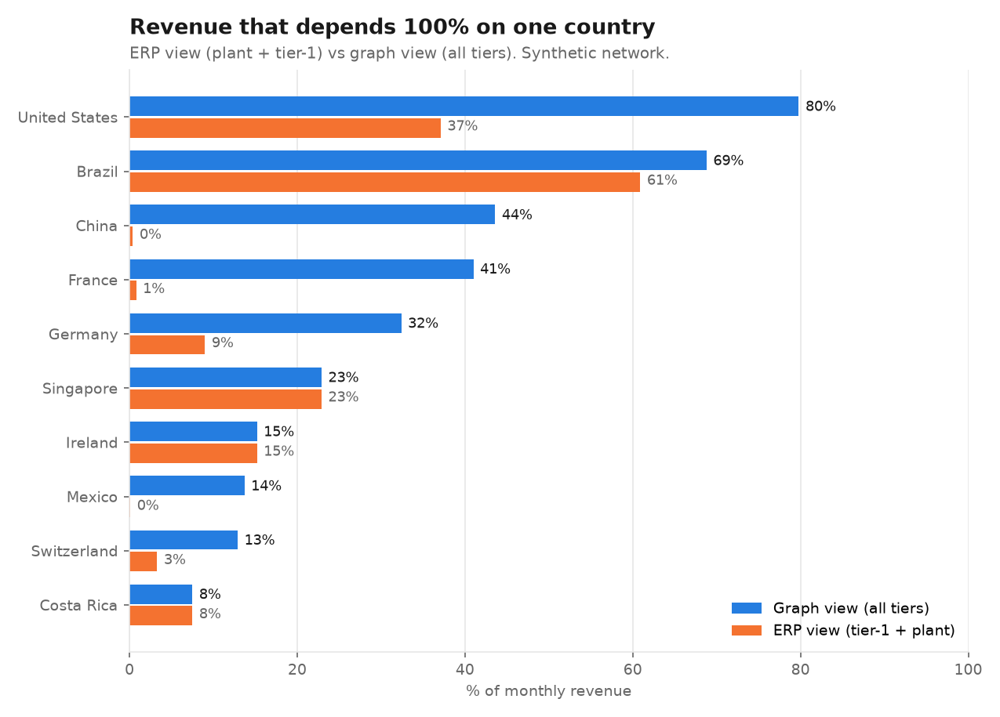
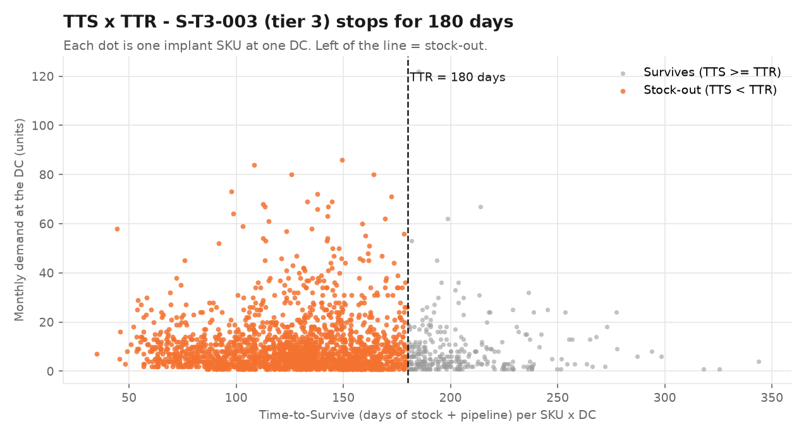

# SupplyGraph OPME

[](https://github.com/gorc-supply/supplygraph-opme/actions/workflows/ci.yml)


**Gêmeo digital em grafo de uma rede de suprimentos multi-tier de implantes ortopédicos e cardiovasculares (OPME):**
matérias-primas (titânio, cromo-cobalto, PEEK, polietileno...), fornecedores tier-1/2/3 em 17 países, plantas, portos
e aeroportos, centros de distribuição no Brasil, 1.400 hospitais e 58 mil lotes rastreáveis de ponta a ponta, em Neo4j.

*English version: [README.md](README.md)*

> **Tese: risco de supply chain é um problema de relacionamentos, não de linhas de tabela.**
> "Qual fornecedor de tier-3 que eu nem conheço derruba metade da minha receita?" é um pesadelo de joins recursivos
> em SQL e um padrão de caminho em grafo. O projeto responde essa pergunta e mede, com honestidade, quanto o grafo
> custa e quanto entrega em comparação com um banco relacional.

> **Honestidade de dados.** A rede é **sintética** (semente fixa), calibrada com dados abertos reais: importações
> brasileiras de implantes em 2024 por país de origem, códigos NCM oficiais (Siscomex) e municípios do IBGE. Todo
> valor em R$ abaixo é sintético e ilustra o método; não é afirmação sobre o mercado brasileiro de OPME.
> Detalhes: [docs/data-sources.md](docs/data-sources.md).

## O caso de negócio em quatro números

| | Visão ERP (pedidos de compra, tier-1) | Visão grafo (rede completa) |
|---|---|---|
| Receita que não existe sem a **China** | **0,4%** | **43,6%** |
| Componentes com 2+ fornecedores que, na prática, têm fonte única (**falso dual-source**) | 0 de 224 (parecem seguros) | **66 de 224 (29%)**, que alimentam **53% da receita** |
| Posição do fornecedor mais perigoso numa visão de gasto / tier-1 | - | os **10 com maior receita em risco são todos tier-2/3**; o primeiro tier-1 é o **74º** |
| Tempo para rastrear um lote de titânio reprovado até cada implante e hospital | dias de planilha | **19 ms**: 105 lotes de implante, 180 hospitais, 26 estados, 684 unidades a bloquear |



## O que tem dentro

- **Modelo de dados** com constraints e índices, e um refinamento do escopo original: o relacionamento
  `BUYS_FROM` registra de qual tier-2 cada tier-1 *de fato* compra, o que torna o falso dual-source visível
  ([modelo e decisões de modelagem](docs/data-model.md)).
- **Pipeline reprodutível**: gerador determinístico com âncoras reais, carga idempotente `UNWIND/MERGE`, alternativa
  com `neo4j-admin import`, 9 verificações de qualidade do grafo rodando como testes.
- **Sete análises de negócio** em Cypher 25 comentado ([análises](docs/analysis.md)): explosão de BOM e where-used,
  falso dual-source, exposição por país ERP × grafo, blast radius com **Time-to-Survive × Time-to-Recover**
  (Simchi-Levi), recall de lote, rotas alternativas (Dijkstra / Yen) e substituição.
- **Graph Data Science**: betweenness, PageRank ponderado, WCC, Leiden, Node Similarity, FastRP + kNN, bridges,
  Dijkstra / Yen, com resultados gravados como propriedades, e um **Índice de Criticidade de Fornecedor** (0–100)
  com análise de sensibilidade dos pesos.
- **Benchmark grafo × relacional**: as mesmas 3 perguntas em Cypher e em CTE recursiva no DuckDB, em 6 tamanhos de
  rede, com respostas idênticas nos 18 pares ([benchmarks](docs/benchmarks.md)).
- **App Streamlit** (PT/EN): visão geral, explorador de rede, simulador de disrupção, recall de lote, ranking de
  criticidade com pesos ajustáveis e metodologia.

## Principais resultados

**Blast radius (TTS × TTR).** Se o fornecedor tier-3 de barra de titânio S-T3-003 parar pelo seu tempo de
recuperação (180 dias), estoque e pipeline cobrem só **35 dias**; 164 implantes entram em ruptura, os 1.400
hospitais são atingidos e **R$ 242 mi** de receita ficam em risco. Fechar o aeroporto de Guarulhos (GRU) por
60 dias custa R$ 30 mi, com rupturas a partir do dia 13.



**Algoritmos de grafo.** O Leiden encontra três bases de suprimento (todo o cardio; quadril + joelho + trauma;
coluna) que atravessam as sete categorias de compra (pureza 0,44): compradores de categorias diferentes negociam
com o mesmo subfornecedor. PageRank e o índice de criticidade colocam no topo hubs tier-2 de forjamento e
revestimento e produtores tier-3 de ligas; o ranking se mantém em quatro ponderações alternativas (Spearman ≥ 0,90).

**Benchmark, a parte honesta.** O DuckDB foi **mais rápido nos 18 casos** (de 1,1× a ~50×): são análises em lote da
rede inteira, o ponto forte de um motor colunar vetorizado, e o tempo do Neo4j inclui a ida e volta pela rede.
O grafo ganha em expressividade (3 contra 20, 10 contra 32 e 26 contra 60 linhas), em perguntas interativas e
pontuais (blast radius de um fornecedor em ~0,3 s, recall em ~19 ms) e nos algoritmos que o SQL não tem.
[Discussão completa](docs/benchmarks.md).

## Índice de criticidade

`índice = 100 × Σ peso_k × minmax(componente_k)`, com pesos em [`config/scoring.yaml`](config/scoring.yaml):
receita em risco (TTS × TTR) 0,35, betweenness 0,15, PageRank 0,15, fonte única 0,15, risco geográfico do país
(proxy sintético) 0,10 e risco financeiro 0,10. Todos os componentes são normalizados (min-max) entre fornecedores.
Na página de ranking da app dá para mexer nos pesos e ver o ranking mudar.

## Como rodar (Windows / PowerShell)

```powershell
git clone https://github.com/gorc-supply/supplygraph-opme.git
cd supplygraph-opme
uv sync --extra app --extra dev          # Python 3.12 + dependências (o uv instala o Python se precisar)
copy .env.example .env                    # defina NEO4J_PASSWORD

# Neo4j Community + APOC + GDS
uv run sgraph up                          # Docker Compose, se o Docker Desktop estiver rodando...
uv run sgraph setup-portable              # ...ou, sem Docker: JDK 21 + Neo4j portáteis em .runtime/
uv run sgraph up --mode portable

uv run sgraph all                         # gerar -> carregar -> validar -> analisar (Cypher + GDS + índice)
uv run sgraph benchmark                   # Cypher x DuckDB, 6 tamanhos de rede x 3 perguntas (~40 min)
uv run streamlit run app/streamlit_app.py # app em http://localhost:8501
```

Outros comandos: `sgraph generate --profile ci|full|bench_*`, `sgraph stats`, `sgraph load --reset`,
`sgraph bulk-import` (neo4j-admin), `sgraph validate`, `sgraph analyze --step cypher|gds|criticality`,
`sgraph export-aura [--dry-run]`, `sgraph fetch-anchors`, `sgraph version`.

Testes: `uv run pytest` (os testes do gerador sempre rodam; os que precisam do Neo4j apagam o banco e só rodam com
`SGRAPH_TEST_ALLOW_RESET=1`).

## Stack

Neo4j Community 2026.10.2 (Cypher 25) · APOC + Graph Data Science 2026.10.2 · Python 3.12 (uv) · driver `neo4j` 6.4 ·
`graphdatascience` 2.4 · pandas · DuckDB 2.0 · Typer · pydantic · Streamlit 1.67 + neo4j-viz + Plotly · pytest ·
ruff · pre-commit · GitHub Actions (Neo4j como service container). Versões e como foram conferidas:
[docs/VERSIONS.md](docs/VERSIONS.md).

## Documentação

- [Modelo de dados](docs/data-model.md) - diagrama Mermaid e decisões de modelagem
- [Análises 9A-9G](docs/analysis.md) - pergunta -> por que grafo -> consulta -> resultado -> recomendação
- [Benchmarks](docs/benchmarks.md) - grafo x relacional e driver x `neo4j-admin import`
- [Fontes de dados](docs/data-sources.md) · [Versões](docs/VERSIONS.md) · [Decisões (ADRs)](docs/decisions/README.md) · [Deploy](docs/deploy.md)
- [Relatório de qualidade de dados](reports/data_quality.md)

Os documentos técnicos detalhados estão em inglês; este README resume tudo em português.

## Licença

MIT - veja [LICENSE](LICENSE). Feito por Gabriel Cunha ([gorc-supply](https://github.com/gorc-supply)).
