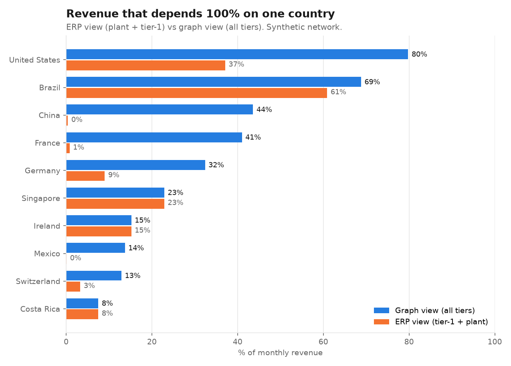
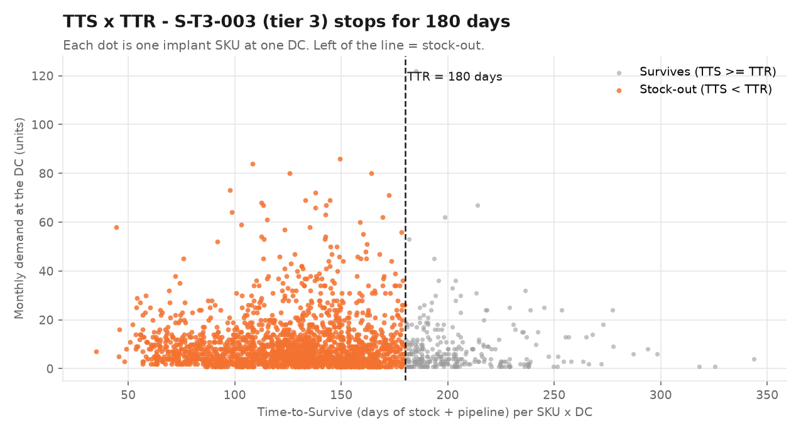
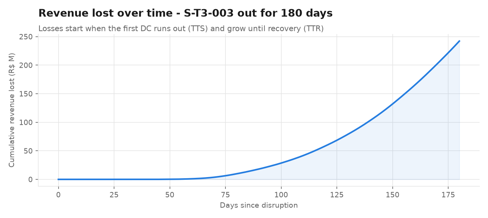
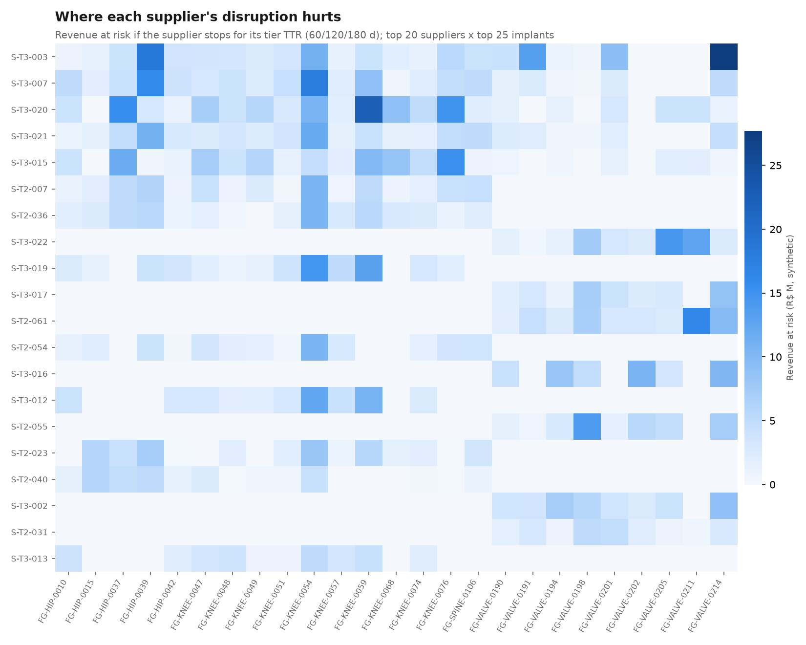

# Business analyses (section 9)

Every analysis follows the same structure: **business question -> why a graph -> query -> result -> recommendation**.
Queries live in [`cypher/analytics/`](../cypher/analytics) (commented), the Python wrappers in
[`src/supplygraph/analytics/queries.py`](../src/supplygraph/analytics/queries.py), raw outputs in
[`reports/analytics/`](../reports/analytics) and headline numbers in [`reports/metrics.json`](../reports/metrics.json).

> **All business numbers below come from the synthetic network (profile `full`, seed 42).** They show what the
> method reveals, not facts about the Brazilian OPME market. Monthly revenue of the synthetic network:
> R$ 287.8 M. Network: 244 suppliers (150 tier-1, 70 tier-2, 24 tier-3), 869 items (240 finished implants),
> 16 plants, 14 DCs, 1,400 hospitals, 57,972 lots.

## A. BOM explosion and where-used

**Question.** "What is this implant made of, at every level?" and "If raw material X goes missing, which implants stop?"

**Why graph.** One variable-length pattern `(c)-[:COMPONENT_OF]->{1,12}(f)` walks every BOM level; the quantity
per implant is the product of `qty_per` along each path (`reduce`), summed over all paths.
Queries: [A1_bom_explosion](../cypher/analytics/A1_bom_explosion.cypher), [A2_where_used](../cypher/analytics/A2_where_used.cypher).

**Result.** The top-revenue implant (FG-VALVE-0211, annuloplasty ring) explodes into 16 lines over 4 levels,
3 of them raw materials. **Ti-6Al-4V ELI titanium is in 167 of the 240 implants, which bring 67.5% of monthly
revenue.**

**Recommendation.** Treat medical-grade titanium as a category-level risk, not an item-level one: one shortage hits
two thirds of the revenue at once. Negotiate frame agreements and safety stock at the raw-material level, and
make the where-used list part of every supplier review.

## B. Hidden multi-tier risk: the false dual-source

**Question.** "Which items look like they have two suppliers, but converge on a single tier-2 or tier-3?"

**Why graph.** A tier-1 supplier's own purchases are a chain of `BUYS_FROM` hops that must follow the BOM (hop
k+1 buys the child *for* the item of hop k). The constraint is checked at every step with Cypher 25
`allReduce()`, which prunes the expansion early ([ADR-004](decisions/ADR-004-cypher25-allreduce.md)).
Query: [B1_hidden_convergence](../cypher/analytics/B1_hidden_convergence.cypher) (`$strict = true`: every hop is a
sole source).

**Result.**
- **224** level-1 components have two or more direct suppliers - in the ERP they look dual- or multi-sourced.
- **66 of them (29.5%) converge 100% on a single upstream supplier**: there is no real alternative.
- Those 66 components go into implants that bring **53.3% of monthly revenue**.
- Without the 100% condition (any share), all 224 share at least one upstream supplier.
- The upstream supplier behind the most false dual-sources is **S-T2-049** (tier-2, China): 15 items.
- Visible single sourcing (exactly one supplier): 81 items.

**Recommendation.** For each of the 66 items, ask both tier-1 suppliers for their sub-tier source list and
qualify a second sub-tier source, or a third tier-1 with an independent chain. Re-run this query after every
supplier onboarding: "two approved suppliers" is not a resilience KPI unless their chains are independent.

## C. Geographic concentration: ERP view vs graph view

**Question.** "How much of our revenue depends on each country - looking at every tier, not only tier-1?"

**Why graph.** Country exposure needs every input of every implant at every level, joined to the supplier
country. Two definitions ([ADR-012](decisions/ADR-012-geo-metrics.md)):
**hard dependency** (the implant has at least one input sourced 100% from the country) and **weighted exposure**
(revenue-weighted largest share of any single input from the country).
Queries: [C2_geo_hard_dependency](../cypher/analytics/C2_geo_hard_dependency.cypher), [C1_geo_exposure](../cypher/analytics/C1_geo_exposure.cypher).

**Result - revenue that cannot be produced without the country (hard dependency):**

| Country | ERP view (plant + tier-1) | Graph view (all tiers) | Hidden |
|---|---:|---:|---:|
| United States | 37.1% | 79.8% | +42.7 pp |
| Brazil | 60.9% | 68.8% | +7.9 pp |
| **China** | **0.4%** | **43.6%** | **+43.2 pp** |
| France | 0.8% | 41.0% | +40.2 pp |
| Germany | 9.0% | 32.4% | +23.4 pp |
| Singapore | 22.9% | 22.9% | 0 |
| Ireland | 15.2% | 15.2% | 0 |
| Mexico | 0.1% | 13.7% | +13.6 pp |

**Reading.** In the purchase-order view China is irrelevant (0.4%). Following the network down to raw material,
43.6% of revenue depends on at least one input that only Chinese suppliers provide. Ireland and Singapore show
zero gap: their exposure is all at plant/tier-1 level, already visible.

**Recommendation.** Country risk reviews must be run on the graph view. Start with the inputs that create the hard
dependency (single-country items in `reports/analytics/C2_geo_hard_dependency.csv` traced with 9A where-used)
and look for a qualified source in another region.

## D. Blast radius: Time-to-Survive vs Time-to-Recover

**Question.** "If supplier / country / port X stops for N days, which implants run out, where, when, and how much
revenue is at risk?"

**Why graph.** The disruption has to be propagated from the node that stops, through sub-tier purchases
(`BUYS_FROM`), up every BOM path to the implants, to every DC that stocks them and every hospital they serve.
Seeds: [D1_seeds_supplier](../cypher/analytics/D1_seeds_supplier.cypher) / [country](../cypher/analytics/D1_seeds_country.cypher) /
[port](../cypher/analytics/D1_seeds_port.cypher); impact: [D2_impact](../cypher/analytics/D2_impact.cypher).

**Model (Simchi-Levi TTS x TTR, [ADR-008](decisions/ADR-008-tts-ttr-model.md)).**
- TTS per (implant, DC) = on-hand cover (`on_hand / avg_daily_demand`) + pipeline (lead time of every stage between
  the disrupted node and the implant: material already past the failure keeps flowing) + plant-to-DC transit.
- TTR per supplier = 60 days for tier-1, 120 for tier-2, 180 for tier-3 (synthetic assumption in
  `config/scoring.yaml`: requalifying a medical-grade raw-material source takes longer than replacing a machining
  shop). Countries and ports use 60 days.
- Where TTS < TTR: units short = daily demand x (TTR - TTS) x share of supply lost; revenue at risk = units x price.

**Result - all 244 suppliers ranked by revenue at risk ([D_supplier_risk_ranking.csv](../reports/analytics/D_supplier_risk_ranking.csv)):**

| Rank | Supplier | Tier | Country | TTR | Revenue at risk | Hospitals hit | First stock-out |
|---:|---|---:|---|---:|---:|---:|---:|
| 1 | S-T3-003 (Ti-6Al-4V bar, 64.9% share) | 3 | US | 180 d | R$ 242.2 M | 1,400 | day 34.8 |
| 2 | S-T3-007 (Ti-6Al-4V, UHMWPE) | 3 | US | 180 d | R$ 203.2 M | 1,400 | day 34.8 |
| 3 | S-T3-020 (CoCr alloy bar) | 3 | CH | 180 d | R$ 203.1 M | 1,394 | day 39.9 |
| 4 | S-T3-021 | 3 | FR | 180 d | R$ 159.7 M | 1,400 | day 34.8 |
| 5 | S-T3-015 | 3 | CN | 180 d | R$ 143.8 M | 1,394 | day 39.9 |
| 6 | S-T2-007 (forging hub, 51 components) | 2 | DE | 120 d | R$ 100.8 M | 1,399 | day 44.5 |
| 7 | S-T2-036 | 2 | CH | 120 d | R$ 100.6 M | 1,400 | day 39.9 |
| 8 | S-T3-022 | 3 | FR | 180 d | R$ 96.6 M | 1,078 | day 54.5 |
| 9 | S-T3-019 | 3 | JP | 180 d | R$ 90.8 M | 1,368 | day 46.4 |
| 10 | S-T3-017 | 3 | CH | 180 d | R$ 90.0 M | 1,142 | day 54.5 |

- **The 10 suppliers with the highest revenue at risk are all tier-2 or tier-3** - none of them appears in a
  purchase order. **The first tier-1 supplier is #74** (S-T1-036, R$ 7.1 M).
- Median revenue at risk per supplier: tier-1 R$ 0.6 M, tier-2 R$ 21.1 M, tier-3 R$ 53.8 M.
- Worst case, S-T3-003 out for 180 days: 164 of the 167 implants that use its titanium stock out somewhere,
  every one of the 1,400 hospitals is affected, the first DC runs dry on **day 35** and R$ 242.2 M of revenue is
  lost over the outage (the network sells R$ 287.8 M per month).
- Scenarios at 60 days: **gateway GRU (Guarulhos airport) closed -> R$ 29.8 M, 107 implants, 1,356 hospitals,
  first stock-out on day 13**; VCP closed -> no impact (every lane has an alternative). Country outages:
  United States R$ 72.0 M, Germany R$ 34.6 M, China R$ 10.0 M (60 days is short against China's deeper, longer pipelines).

**Recommendation.** Put the top-20 of this ranking - not the top-20 by spend - in the supplier risk programme:
require sub-tier disclosure and business-continuity plans, and size strategic stock of titanium and CoCr bar to
cover the gap between TTS (~35 days) and a realistic TTR for a raw-material producer. For GRU, pre-agree a
VCP/GIG routing and customs broker so the 13-day window is not consumed by paperwork.

## E. Lot traceability and recall

**Question.** "A titanium lot failed inspection: which implant lots derive from it, which hospitals received them
and how many units are still in stock?"

**Why graph.** Genealogy is a DAG of unknown depth. Forward trace = `(l)-[:DERIVED_FROM]->{1,12}(src)`, backward
trace = the same pattern from the other end. Queries: [E1_recall_forward](../cypher/analytics/E1_recall_forward.cypher),
[E2_recall_backward](../cypher/analytics/E2_recall_backward.cypher).

**Result.** Raw lot **RM-TI64-L0043** (Ti-6Al-4V bar):
- 157 derived lots, of which **105 implant lots**;
- **5,881 units already delivered to 180 hospitals in 26 states**;
- **684 units still in stock** to quarantine immediately;
- forward trace **19 ms**, backward trace from an implant lot to the titanium heat **3 ms** (median of 10 runs).

**Recommendation.** Keep lot genealogy in a graph that the quality team can query directly: the recall perimeter
is known in milliseconds, so the conversation moves straight to the 684 units that can still be stopped and to
the hospital notification list (exportable from the app's *Lot recall* page).

## F. Alternative supply routes

**Question.** "What is the fastest and the cheapest route from a plant to a hospital, and what if a gateway closes?"

**Why graph.** Weighted shortest paths. Pure Cypher enumeration ([F1_routes](../cypher/analytics/F1_routes.cypher),
runs on Aura without GDS) and GDS Dijkstra + Yen k-shortest paths (`supplygraph.gds.algorithms._routes`) give the
same answer.

**Result.** Plant P-01 (Costa Rica) to hospital H-0176 (Bahia): fastest route **14.9 days**, cheapest **R$ 49.83 per
unit** - the same route (P-01 > SJO > VCP > DC-SP2 > DC-BA1), so the lead time x cost Pareto frontier has a single
point. With GRU closed the best route is unchanged (it already uses VCP). GDS Yen returns the same top-5.
GDS bridges show the real single corridors: several plants have **one** gateway (e.g. SJO -> P-01, DUB -> P-02,
FRA -> P-03) and DC-AM1 (Manaus) is reachable only from DC-SP1. DCs PA1 and AM1 serve 79 and 46 hospitals through a
single inbound lane.

**Recommendation.** Qualify a second export gateway for single-gateway plants and a second replenishment lane for
Manaus and Belém; these are cheap to arrange in advance and impossible to improvise during a disruption.

## G. Substitution

**Question.** "Which stock-outs from scenario D can be covered by a qualified substitute, and how fast?"

**Query.** [G1_substitutes](../cypher/analytics/G1_substitutes.cypher): substitutes not hit by the same disruption,
with requalification time and stock at the same DC. Fully mitigable if requalification <= TTS, partially if < TTR.

**Result.** Worst supplier scenario: substitutes recover only **1.0% of the revenue at risk** (11 of 1,909
SKU x DC stock-outs fully mitigable). Germany 60-day scenario: 0%. The reason is structural: substitutes in the
same category share the same sub-tier suppliers and raw materials, so they fail together.

**Recommendation.** A substitute only counts as mitigation if its supply chain is independent. Add "no shared
tier-2/tier-3 with the primary" to the qualification criteria for substitutes.

## 10. Graph Data Science

Projections (always dropped at the end), [ADR-009](decisions/ADR-009-precompute-gds.md):

| Projection | Nodes / relationships | Why these nodes and weights | Algorithms |
|---|---|---|---|
| `sg_flow` | 2,562 / 26,560, undirected | the material-flow network end to end | Betweenness, WCC |
| `sg_dependency` | 2,529 / 34,931, directed dependent -> provider | revenue (hospital -> implant) and share weights flow importance to whoever everything depends on | PageRank (weighted) |
| `sg_sourcing` | 1,113 / 15,900, undirected | suppliers, items, BOM and sub-tier purchases | Leiden, FastRP |
| `sg_portfolio` | 1,113 / 1,427 | supplier -> item | Node Similarity (Jaccard) |
| `sg_logistics` | 1,449 / 1,931 (+ undirected copy) | plants, ports, DCs, hospitals with lead time and cost | Dijkstra, Yen, WCC, bridges, articulation points |

**Results.**
- **Betweenness:** the chokepoints of the flow are the São Paulo DCs (DC-SP1, DC-SP2) and DC-RJ1.
- **PageRank (revenue-weighted):** the five most important suppliers are tier-2 (S-T2-036, S-T2-054, S-T2-007,
  S-T2-040) and tier-3 (S-T3-003) - again, invisible to the ERP.
- **WCC:** one connected network (no isolated sub-network); the single-corridor question is answered by bridges.
- **Leiden** (modularity 0.53): 3 large supply-base clusters - all cardiovascular categories together; hip, knee
  and trauma together; spine (PEEK) on its own. Purity against the 7 purchasing categories is only 0.44 (NMI 0.61),
  against the 2 product families 1.0. Purchasing categories split what the supply base joins.
- **Node Similarity:** 406 `SIMILAR_PORTFOLIO` relationships; e.g. the CoCr producer S-T3-020 has a portfolio twin
  in S-T3-015 (Jaccard 1.0) - a candidate alternative, but in the same risk list, so not a real hedge.
- **FastRP + kNN:** structurally similar suppliers in `reports/analytics/GDS_fastrp_knn_suppliers.csv`.

**Recommendation.** Organise category management around the three supply-base clusters, not the seven product
categories: a hip buyer and a knee buyer negotiating separately with the same tier-2 forging house are bidding
against themselves.

### Supplier Criticality Index (0-100)

`index = 100 x sum(weight x min-max(component))`, weights in [`config/scoring.yaml`](../config/scoring.yaml):
revenue at risk 0.35, betweenness 0.15, PageRank 0.15, single source 0.15, country geo-risk 0.10, financial risk 0.10.

| Rank | Supplier | Tier | Country | Index |
|---:|---|---:|---|---:|
| 1 | S-T3-003 | 3 | US | 65.9 |
| 2 | S-T2-007 | 2 | DE | 64.7 |
| 3 | S-T2-054 | 2 | US | 64.4 |
| 4 | S-T2-036 | 2 | CH | 63.2 |
| 5 | S-T3-020 | 3 | CH | 53.7 |

Top 10: 6 tier-2 and 4 tier-3 suppliers, no tier-1.

**Sensitivity** ([criticality_sensitivity.csv](../reports/analytics/criticality_sensitivity.csv)):

| Weight scenario | Spearman vs base | Top-10 overlap | #1 |
|---|---:|---:|---|
| revenue-heavy | 0.980 | 8 / 10 | S-T3-003 |
| structure-heavy | 0.969 | 8 / 10 | S-T2-054 |
| risk-heavy | 0.900 | 8 / 10 | S-T2-007 |
| equal weights | 0.986 | 9 / 10 | S-T2-007 |

The ranking is robust: Spearman correlation stays at 0.90 or above, at least 8 of the top 10 are kept, and the #1 is always one of S-T3-003, S-T2-007 or S-T2-054. The app's
*Criticality ranking* page lets you move the weights and watch the ranks change.
