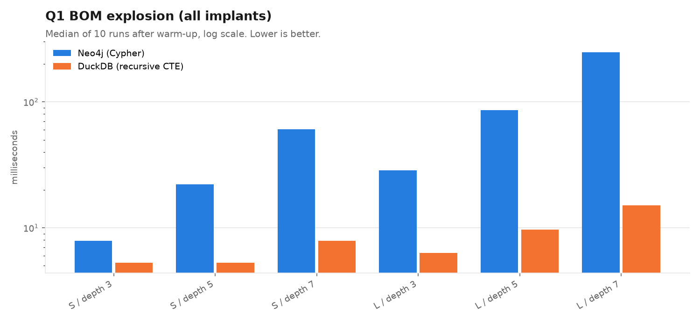
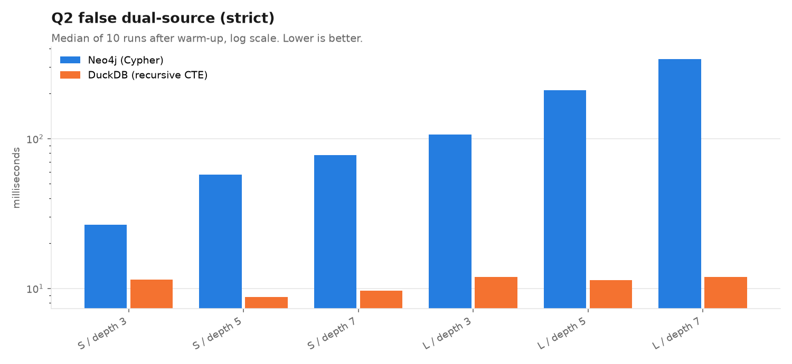
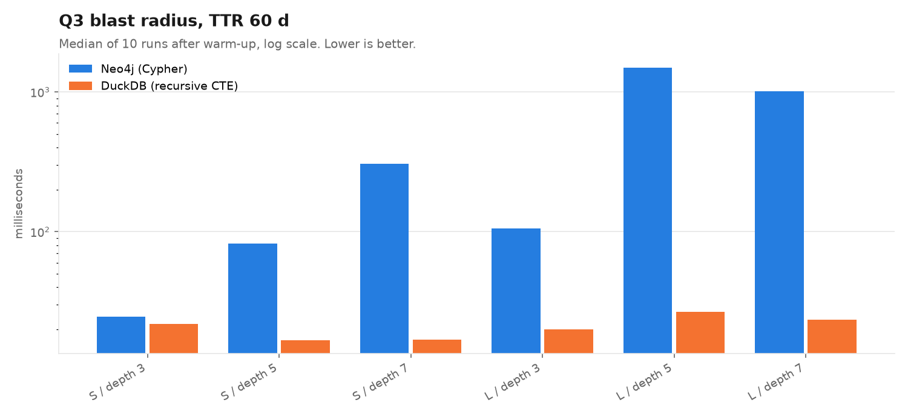

# Benchmarks

All timings measured on the build machine: Windows 11, 16 threads, 32 GB RAM; Neo4j Community 2026.10.2 (portable,
2 GB heap, 1 GB page cache); Python 3.12; DuckDB 2.0.1. Synthetic data, seed 42.

## 1. Loading: transactional driver vs `neo4j-admin database import`

Profile `full`: 60,560 nodes, 238,467 relationships.

| Strategy | Command | Time | Notes |
|---|---|---:|---|
| (a) Transactional load via the Python driver | `sgraph load --reset` | **15.3 s** | `UNWIND $rows MERGE` in batches of 5,000, managed transactions, server online, idempotent (second run: same counts, ~11 s) |
| (b) Offline bulk import | `sgraph bulk-import` | **10.5 s** import | + 8.3 s to create constraints/indexes and enrichment; **38.8 s end to end** including stopping and restarting the server |

**Reading.** At this size the bulk importer is only faster in the import step itself; once the restart and the
index build are counted, the online driver load wins and keeps the database available. `neo4j-admin import`
pays off for the first load of much larger graphs (millions of relationships), where `MERGE` per row becomes the
bottleneck, and it requires the server to be offline (Community Edition has a single user database). The project
therefore uses the driver load by default and keeps the bulk import as a documented, tested alternative
(`supplygraph.load.admin_import` builds typed-header CSVs from the same tables).

## 2. Graph (Neo4j / Cypher) vs relational (DuckDB / recursive CTE)

**Setup.** Same data in both engines (the generator writes one set of normalised tables; the loader puts it in
Neo4j, DuckDB reads the CSVs into in-memory tables). Same three questions, written once in Cypher
([`cypher/benchmark/`](../cypher/benchmark)) and once in SQL
([`src/supplygraph/benchmark/sql/`](../src/supplygraph/benchmark/sql)):

- **Q1** multi-level BOM explosion of every implant down to raw material, with quantities;
- **Q2** false dual-source (strict, BOM-consistent sub-tier chains) - section 9B;
- **Q3** blast radius of the most depended-upon supplier stopping for 60 days (TTS x TTR) - section 9D.

Six networks: BOM depth 3 / 5 / 7 x size S (~2.5k nodes, ~40k relationships) and L (~9-10k nodes,
~145-157k relationships); lots are excluded (none of the questions use them). Timing = median of 10 runs after
2 warm-up runs, measured from Python (`sgraph benchmark`). **Every one of the 18 pairs returned the same answer**
(row count and checksum), so the comparison is like for like. Machine: Windows 11, 16 threads, 32 GB RAM;
Neo4j Community 2026.10.2 with 2 GB heap; DuckDB 2.0.1 in-process.

| Network | Q1 BOM explosion: Neo4j / DuckDB (ms) | Q2 false dual-source | Q3 blast radius |
|---|---:|---:|---:|
| S, depth 3 | 7.9 / 5.3 | 26.6 / 11.5 | 24.7 / 22.0 |
| S, depth 5 | 22.2 / 5.3 | 57.5 / 8.8 | 82.0 / 16.8 |
| S, depth 7 | 60.8 / 7.9 | 77.8 / 9.7 | 306.4 / 16.9 |
| L, depth 3 | 28.6 / 6.3 | 106.7 / 11.9 | 105.9 / 20.1 |
| L, depth 5 | 86.1 / 9.7 | 210.8 / 11.4 | 1,492.8 / 26.6 |
| L, depth 7 | 247.8 / 15.1 | 340.3 / 11.9 | 1,008.9 / 23.5 |

| | Q1 | Q2 | Q3 |
|---|---:|---:|---:|
| Lines of code - Cypher | 3 | 10 | 26 |
| Lines of code - SQL | 20 | 32 | 60 |
| SQL CTEs / JOINs | 2 / 3 | 4 / 5 | 6 / 9 |

### Honest reading

**DuckDB was faster in all 18 cases**, from 1.1x (small, shallow network) to about 50x (large, deep network,
blast radius). This is not the result the "graphs are faster" slogan predicts, and it is worth explaining:

1. **These three questions are whole-network analytics.** Explode *every* BOM, scan *every* multi-sourced item.
   That is a set-based, scan-heavy workload, exactly what a vectorised columnar engine like DuckDB is built for.
   The tables are tiny for DuckDB (the largest has ~100k rows) and fit in cache.
2. **Path semantics vs set semantics.** Cypher's variable-length patterns enumerate every *path*, then aggregate;
   with deeper BOMs and shared sub-assemblies the number of paths grows much faster than the number of
   (implant, raw material) pairs. DuckDB's recursive CTE also expands paths, but in vectorised batches.
   The Q3 Cypher additionally runs a subquery per sub-tier chain.
3. **Measurement includes the client round trip for Neo4j** (Bolt protocol, result serialisation into Python),
   while DuckDB runs inside the Python process. For the small cases this is a visible share of the time.
4. **Community Edition** runs queries single-threaded (the parallel runtime is an Enterprise feature).

Where the graph still wins:

- **Readability and change cost:** 3 vs 20, 10 vs 32 and 26 vs 60 lines. The Q2 SQL needs four CTEs and five
  joins to say what one pattern with a per-hop condition says in Cypher; adding one more tier or relationship type
  to a Cypher pattern is a one-line change.
- **Interactive latency on an operational store:** all Cypher answers except the deepest blast radius return in
  under 350 ms, and the point-anchored questions the app asks (one supplier's blast radius: ~0.3 s; one lot's
  recall: ~20 ms forward, ~3 ms backward) are well within interactive range, on a transactional database that
  also serves the app.
- **Graph algorithms** (betweenness, PageRank, Leiden, node similarity, Yen) have no equivalent in DuckDB.

**Conclusion.** The case for the graph here is expressiveness and the ability to ask new relationship questions
quickly, not raw speed on batch analytics. For a nightly batch that recomputes the full risk ranking, a columnar
engine over the same tables is the cheaper option - and this repository shows both side by side.

Raw results: [`reports/benchmark/results.csv`](../reports/benchmark/results.csv). Re-run: `uv run sgraph benchmark`.
