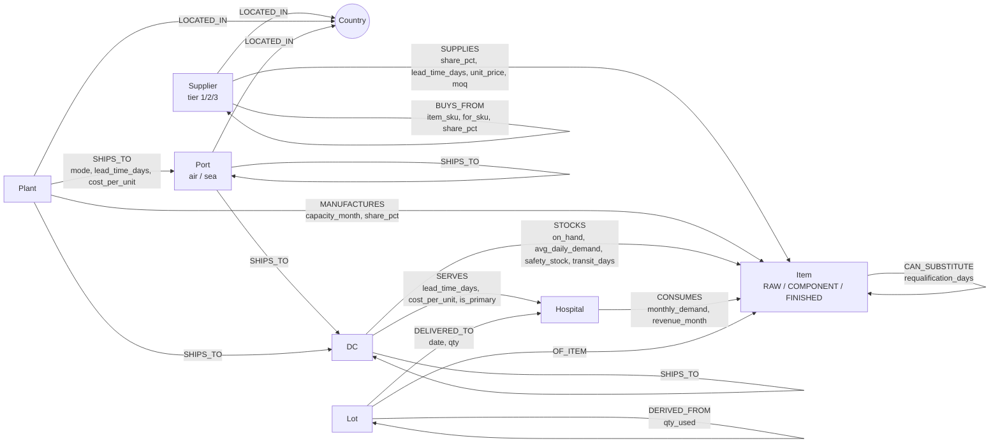

# Data model

Written by GDS (section 10): node properties `betweenness`, `pagerank`, `component_id`, `logistics_component`,
`community_id`, `criticality_index`, `criticality_rank`, `revenue_at_risk`; relationship `SIMILAR_PORTFOLIO {jaccard}`
between suppliers.

## Nodes

| Label | Key | Main properties |
|---|---|---|
| `Country` | `iso2` | `name`, `region`, `geo_risk_score` (0-1, synthetic proxy), `import_share_9021` (real anchor) |
| `Port` | `code` (IATA for airports, UN/LOCODE for seaports) | `name`, `country_iso2`, `type` (air/sea) |
| `Supplier` | `id` (`S-T2-007`) | `name`, `tier`, `country_iso2`, `family`, `financial_risk`, `capacity_month`, `is_certified` |
| `Item` (+ `:Critical`) | `sku` | `name`, `type`, `category`, `family`, `level`, `anvisa_risk_class` (finished only), `ncm` (finished only, validated), `unit_cost`, `unit_price`, `criticality`, `pipeline_lead_days`, `revenue_month` |
| `Plant` | `id` | `name`, `country_iso2`, `family` |
| `DC` | `id` | `name`, `uf`, `municipality`, `lat`, `lon` |
| `Hospital` | `id` | `name`, `uf`, `municipality`, `lat`, `lon`, `type` (public/private), `size_index` |
| `Lot` | `lot_id` | `item_sku`, `qty`, `mfg_date`, `expiry_date` (Neo4j `date`), `status` (released/quarantine/recalled/expired), `source_id` |

Constraints and indexes: [`cypher/00_schema.cypher`](../cypher/00_schema.cypher) (idempotent, `IF NOT EXISTS`).

## Modelling decisions (what a technical reviewer will ask)

**1. Why is lead time on the relationship and not on the node?**
Lead time is a property of a *pair*: the same item has different lead times from different suppliers, and the same
DC is 1 day from one hub and 4 from another. Putting it on `SUPPLIES` / `SHIPS_TO` / `SERVES` lets weighted path
algorithms (Dijkstra, Yen, TTS pipeline) read it directly as the edge weight. The node keeps only an *aggregate*
(`Item.pipeline_lead_days` = share-weighted supplier lead time) used to estimate inventory already in the pipeline.

**2. Why is `Lot` a node and not a property?**
Genealogy is a many-to-many DAG (one titanium heat feeds dozens of component lots; one implant lot consumes several
component lots) and each lot has its own lifecycle (status, expiry, deliveries). As nodes, forward and backward
traces are one variable-length pattern (`(l)-[:DERIVED_FROM]->{1,12}(src)`); as properties they would be lists
that cannot be indexed, traversed or constrained.

**3. Extra label (`:Critical`) vs property (`criticality`).**
`criticality` keeps the full value (HIGH/MEDIUM/LOW). `:Critical` is added only for HIGH because "show me the
critical items" is the most common filter: a label is a cheap entry point for the planner and reads naturally in
patterns (`(i:Item:Critical)`). Rule used: a label for a small, stable, frequently-filtered class; a property for
anything continuous or multi-valued.

**4. Why `BUYS_FROM (Supplier)->(Supplier)` on top of `SUPPLIES`?** (refinement of the brief)
`SUPPLIES` says *who can sell an item to the network* and its market share. It cannot say *which* tier-2 a given
tier-1 actually buys from. That is exactly the information needed to detect a **false dual-source** (two tier-1s
that both depend on the same tier-2). `BUYS_FROM` carries `item_sku` (what is bought) and `for_sku` (the item it
is used for), so a sub-tier chain can be required to follow the BOM. See [ADR-003](decisions/ADR-003-buys-from.md).

**5. How to avoid supernodes.**
`Country` would become a supernode if lots or hospitals pointed to it, so only suppliers, plants and ports have
`LOCATED_IN`; DCs and hospitals carry `uf` as a property. Commodity raw materials (Ti-6Al-4V) are used by hundreds
of BOM lines - acceptable because traversals reach them at the end of a pattern, never fan out from them unanchored.
Lots never link to countries or suppliers (they store `source_id`) to avoid tens of thousands of edges on a few nodes.

**6. Why `share_pct` on `MANUFACTURES` and `is_primary` on `SERVES`?** (additions)
To simulate a country or plant outage we need the share of production lost; to compute the primary DC of each
hospital (stock attribution, single-corridor analysis) we need to know which lane is the primary one.

**7. Why a 4th lot status `expired`?**
The brief lists released/quarantine/recalled and asks that "expired lots are never released". An explicit `expired`
status makes the rule testable both ways (check 07 fails if someone flips an expired lot back to released).

**8. Why the BOM is a DAG by construction.**
The generator assigns every item a level (finished = 0, components 1..D-1, raw at the bottom) and only links a
child to a parent one or more levels above. Check `01_bom_is_dag` still verifies it on the loaded graph and a
negative test injects a cycle to prove the check works.
